# InfoMeet: community forum with React and ASP.NET Core

A Reddit-style forum where people join communities, write posts, comment, vote and chat with each other in real time. Community owners and moderators manage their communities, and an admin panel keeps the whole platform in check.

This was a university team project. The section [My part](#my-part) lists what I built.

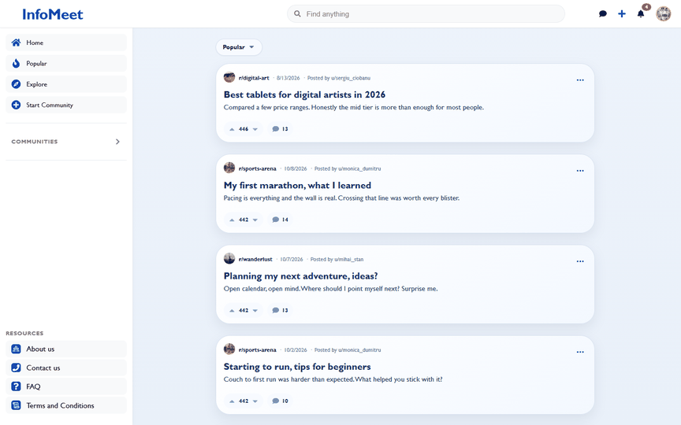

*Browsing a community, commenting on a post and sending a live message.*

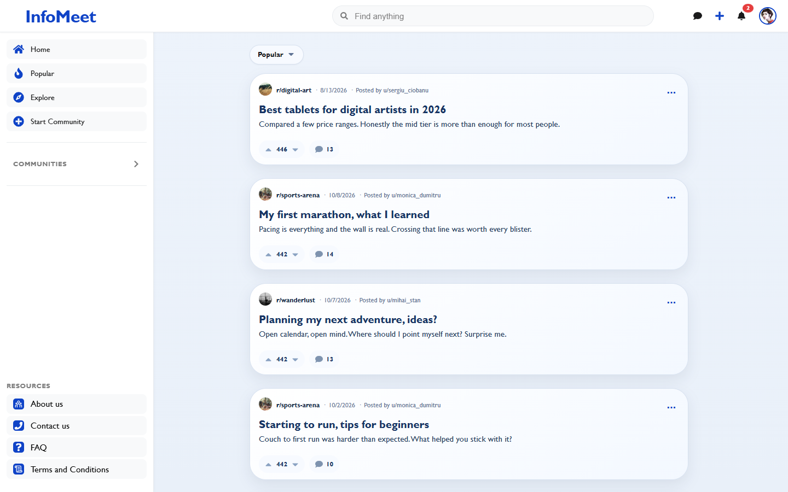

| Community | Post and comments |
|---|---|
| 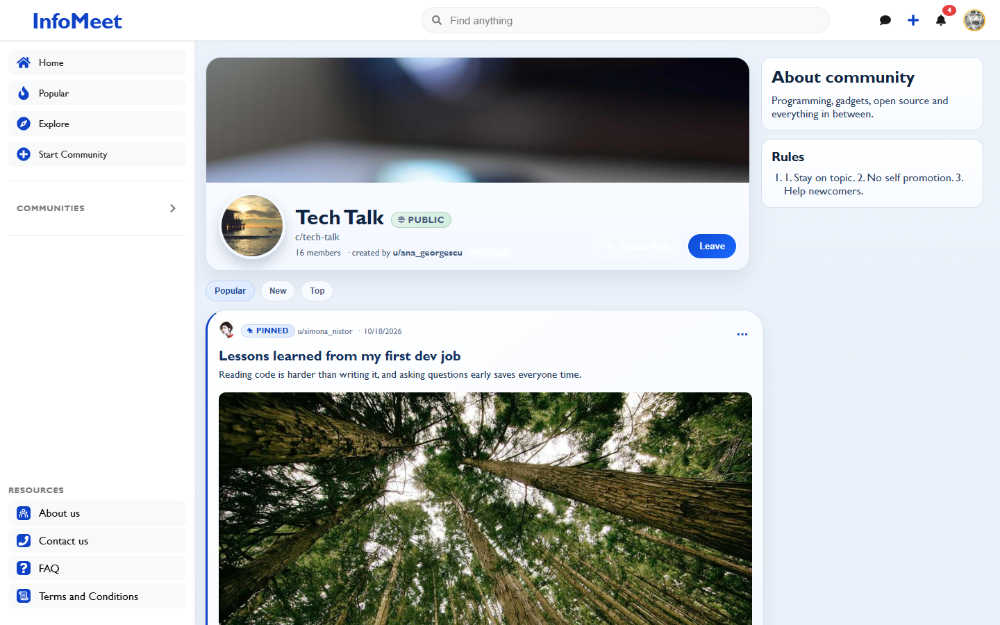 | 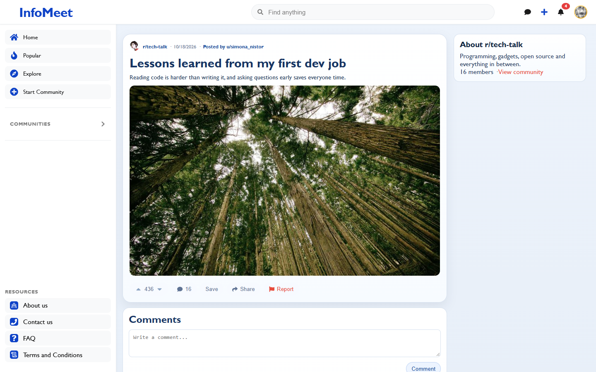 |

| Real-time messages | Profile |
|---|---|
| 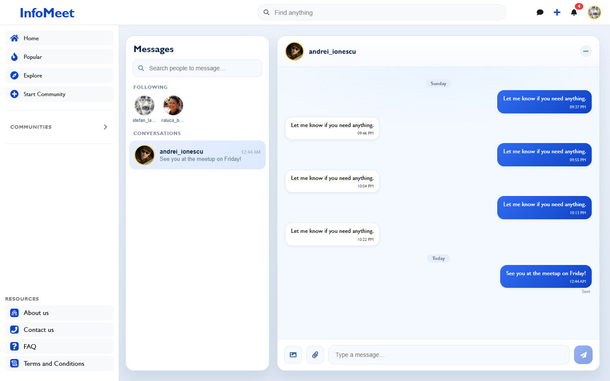 | 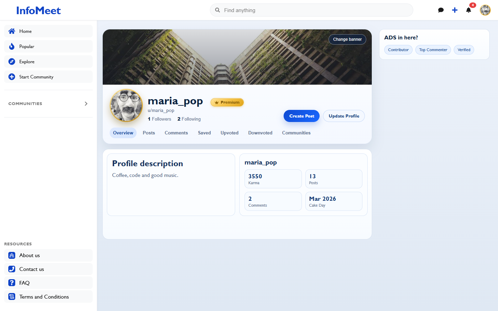 |

| Explore communities | Admin panel |
|---|---|
| 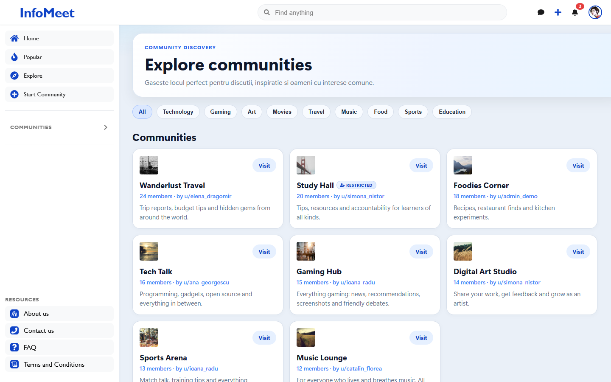 | 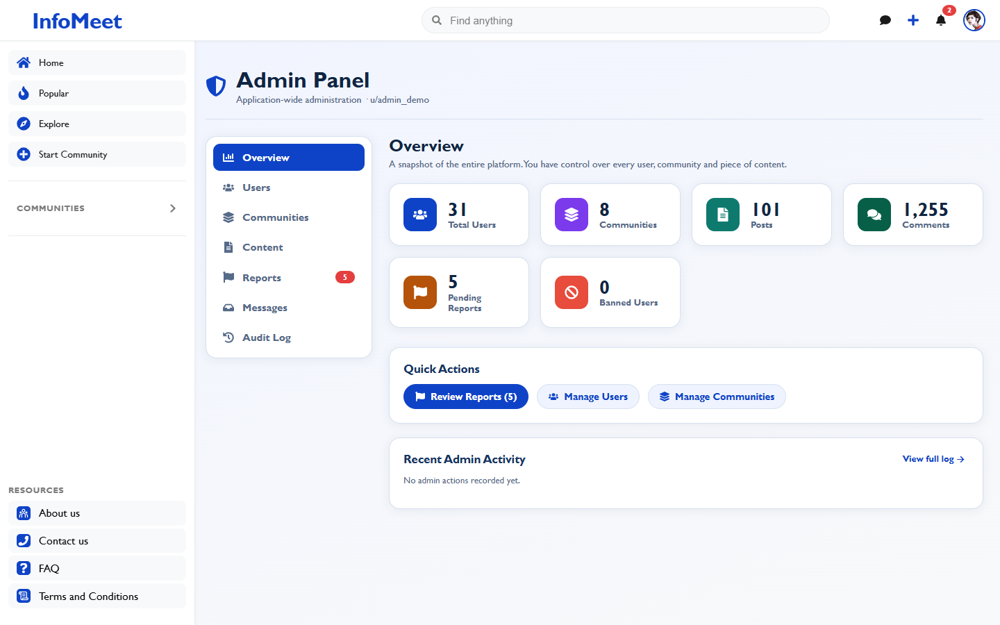 |

| Create a post | Log in | Phone |
|---|---|---|
| 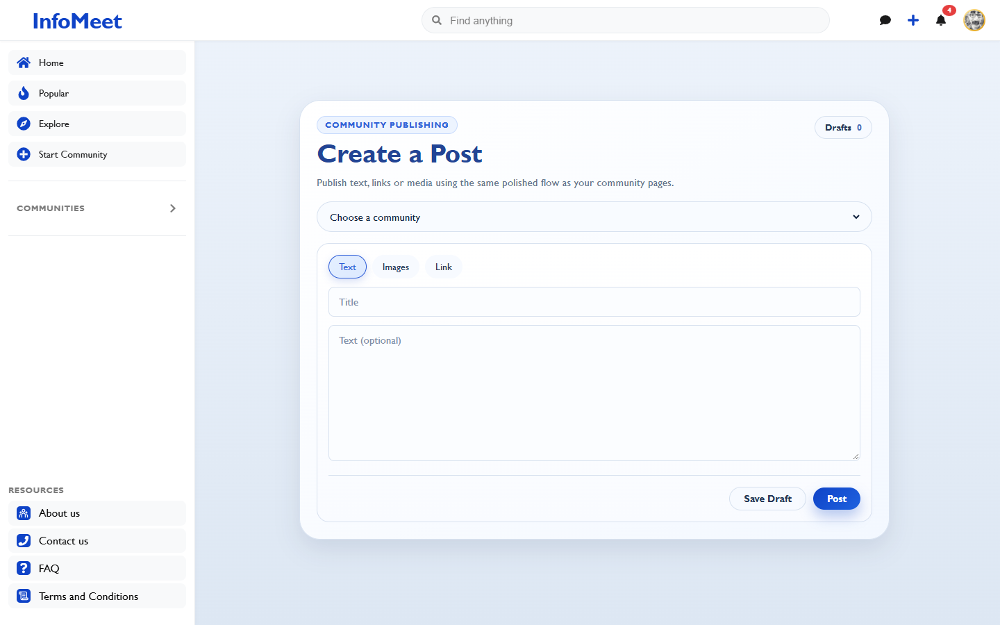 | 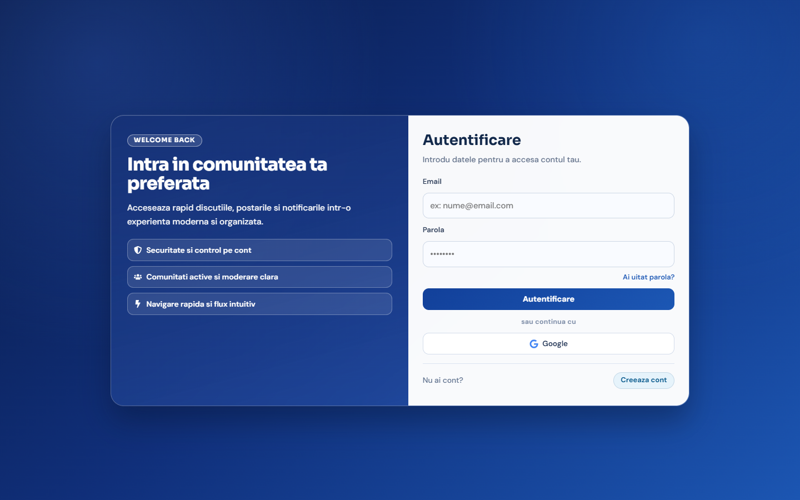 | 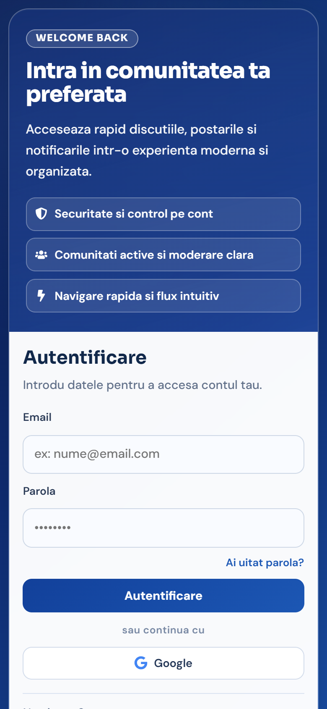 |

## Features

- **Communities**: public, restricted or private, each with its own rules, banner and avatar. Explore and join them by category.
- **Posts and comments**: text, image and link posts, nested replies, up/down votes, saved posts and drafts.
- **Real-time messaging and notifications** with SignalR: one-to-one chat (with images) and live notifications for follows, replies and votes.
- **Moderation**: owners and moderators can promote, kick and ban members, see community statistics and handle reports.
- **Admin panel**: platform statistics, users, communities, content, reports and an audit log.
- **Accounts**: sign up with email confirmation, log in with a 6-digit code sent by email, password reset, or Google sign-in. JWT access tokens are kept in memory and refreshed with a refresh token.
- **Profiles** with posts, comments, saved and voted tabs, followers and settings.
- **Premium plan** (simulated payment, no card data stored) and ads loaded from an external API for free users.
- **Search** across posts, communities and users.

## Tech stack

| Layer | Technologies |
|---|---|
| Frontend | React 19, Vite, React Router 7, SignalR client, Google OAuth |
| Backend | ASP.NET Core 8 Web API, SignalR, Swagger |
| Architecture | Layered: API, BusinessLayer, DataAccess, Domain |
| Database | SQL Server with Entity Framework Core (migrations applied on startup) |
| Auth | JWT + refresh tokens, BCrypt, email codes over SMTP, Google sign-in |
| Tests | xUnit (62 business-layer tests) |

## Getting started

Requirements: .NET 8 SDK, Node.js 18+ and SQL Server (Express is enough).

**1. Backend**

```bash
cd Backend/Forum_Backend/ForumApp.API
copy appsettings.Development.example.json appsettings.Development.json
```

Set `JwtSettings:Secret` to any random string of 32+ characters and check the connection string. Then:

```bash
dotnet run --launch-profile http        # http://localhost:5129, Swagger at /swagger
```

The database and tables are created automatically. To fill it with demo data (30 users, 8 communities, posts, comments, votes and chats), run `database/seed_demo_data.sql` once in SQL Server Management Studio or with `sqlcmd`.

**2. Frontend** (in a second terminal)

```bash
cd Frontend/Forum_Project
npm install
npm run dev                              # http://localhost:5173
```

**Logging in**

All demo users have the password **Password123!** (for example `maria_pop@example.com`, or `admin@forum.demo` for the admin panel). Login asks for a 6-digit code:

- If `Email:SenderEmail` and `Email:AppPassword` (a Gmail app password) are set, the code is emailed.
- If they are empty, the code is printed in the backend console, so the project runs without an email account.

**Tests**

```bash
cd Backend/Forum_Backend
dotnet test
```

## Project structure

```
Backend/Forum_Backend/
  ForumApp.API/              controllers, SignalR hub, email/image/ads adapters, Program.cs
  ForumApp.BusinessLayer/    business rules (Core), interfaces, services
  ForumApp.DataAccess/       EF Core DbContext and migrations
  ForumApp.Domain/           entities and DTOs
  ForumApp.BusinessLayer.Tests/
Frontend/Forum_Project/src/  pages, contexts (auth, chat, notifications, toasts), styles
database/seed_demo_data.sql  demo data
```

## My part

I worked on both the backend and the frontend. The main features I built:

- **Security**: moved every endpoint from trusting a `userId` sent by the client to reading the user from the JWT, so nobody can act as someone else by changing an id. Added Google sign-in.
- **Email flows**: account confirmation, 6-digit login codes and password reset over SMTP, with HTML emails.
- **Real-time chat** between two users, similar to Instagram or Messenger, with SignalR.
- **Community moderation**: owner and moderator roles (promote, kick, ban), statistics, community rules, and public / restricted / private communities.
- **Admin panel** for the whole platform.
- **Premium plan and ads** from an external API.
- **Images** for posts, communities and avatars, stored on the server and referenced from the database.
- **Profiles**: editing username, password and description, and tabs for a user's posts, comments, saved and voted items.
- **Search bar** and many fixes to business-layer error messages and the UI.
- **Unit test project** for the business layer.

The interface text is in Romanian and English, as it was built for a Romanian-speaking audience.
